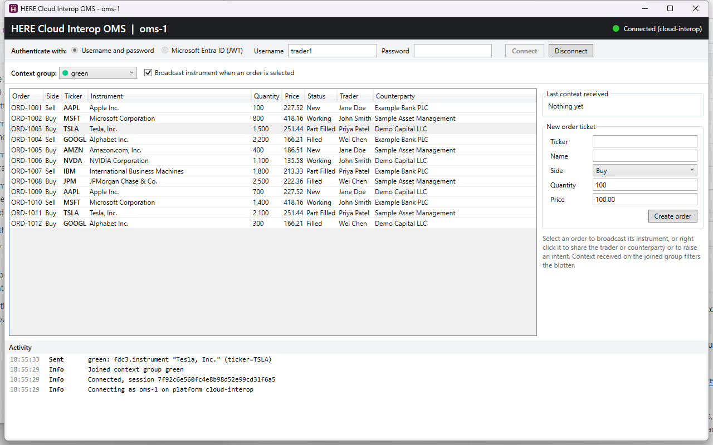
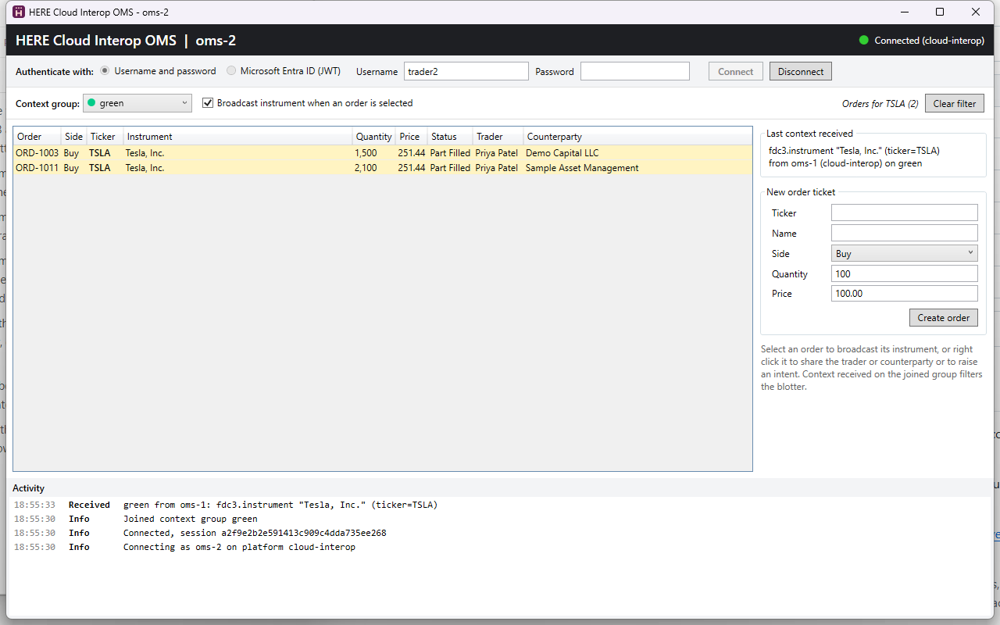
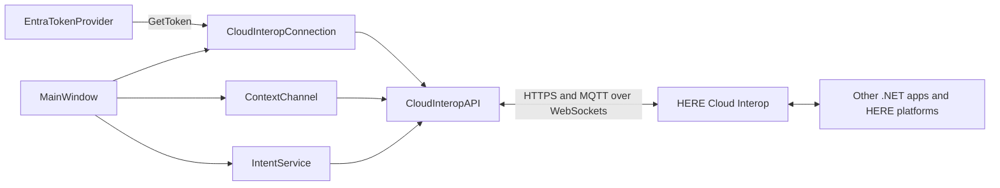
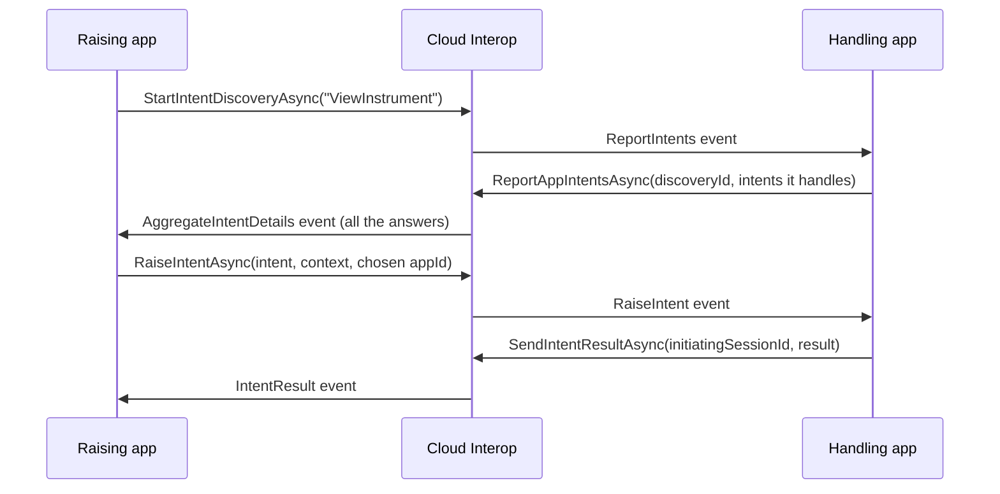
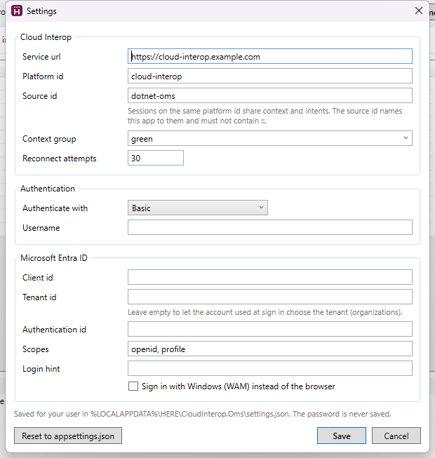

# Use Cloud Interop from .NET

This example shows how a .NET application, on either **.NET Framework 4.8** or **.NET 10**, can share FDC3 context and raise and handle FDC3 intents with other applications through HERE Cloud Interop, using the [OpenFin.CloudInterop](https://www.nuget.org/packages/OpenFin.CloudInterop/1.0.0-alpha.a53b106) NuGet package.

You can connect with a **username and password** issued by HERE, or with a **JWT** (an ID token) from **Microsoft Entra ID**.

The other side can be:

- another copy of this app
- any other .NET app using the package
- a HERE platform using [@openfin/cloud-interop](https://www.npmjs.com/package/@openfin/cloud-interop), such as the [Cloud Interop with Entra ID](https://github.com/built-on-openfin/container-starter/tree/main/how-to/use-interop/cloud-interop-entra) container-starter example

The example is a small order management system (OMS), but the OMS is only there to give the example something to share. The parts worth reading are in [CloudInterop/](./CloudInterop.Oms/CloudInterop) and [Auth/](./CloudInterop.Oms/Auth).

> **_:warning: Alpha package:_** `OpenFin.CloudInterop` is a prerelease and its API may change. This example was built against `1.0.0-alpha.a53b106`.





## Before you start

Cloud Interop is a hosted service, so you need the following from HERE:

| Setting | What it is |
| --- | --- |
| `url` | The url of the Cloud Interop service. |
| `platformId` | Sessions only share context and intents with sessions on the same platform id. The container-starter examples use `cloud-interop`. |
| Username and password | Needed for basic authentication. |
| `authenticationId` | Needed for JWT authentication. HERE issues this once you have told them how to validate your tokens (see [Tell HERE about your tokens](#tell-here-about-your-tokens)). |

## Where things are

| File | What it does |
| --- | --- |
| [CloudInterop/CloudInteropConnection.cs](./CloudInterop.Oms/CloudInterop/CloudInteropConnection.cs) | Creates the `CloudInteropAPI` client, connects with basic or JWT authentication, disconnects and reports the connection status. |
| [CloudInterop/ContextChannel.cs](./CloudInterop.Oms/CloudInterop/ContextChannel.cs) | Joins a context group, broadcasts context to it and raises an event for context received on it. |
| [CloudInterop/IntentService.cs](./CloudInterop.Oms/CloudInterop/IntentService.cs) | Raises intents (discover, raise, await the result) and handles the intents this app supports. |
| [CloudInterop/Fdc3.cs](./CloudInterop.Oms/CloudInterop/Fdc3.cs) | Builds and reads `fdc3.instrument`, `fdc3.contact`, `fdc3.organization` and `fdc3.order` contexts. |
| [Auth/EntraTokenProvider.cs](./CloudInterop.Oms/Auth/EntraTokenProvider.cs) | Signs in to Entra ID with MSAL.NET and supplies the ID token to Cloud Interop. |
| [Settings.cs](./CloudInterop.Oms/Settings.cs), [appsettings.json](./CloudInterop.Oms/appsettings.json) and [SettingsWindow.xaml.cs](./CloudInterop.Oms/SettingsWindow.xaml.cs) | Default settings, the Settings window that edits and saves them, and command line overrides. |
| [MainWindow.xaml.cs](./CloudInterop.Oms/MainWindow.xaml.cs) | The OMS window, which wires the classes above to the UI. |



## 1. Install the package and connect

```powershell
dotnet add package OpenFin.CloudInterop --prerelease
```

The package contains `lib/net48` and `lib/net10.0` builds and NuGet picks the right one for your project. This project builds both from one project file:

```xml
<TargetFrameworks>net48;net10.0-windows</TargetFrameworks>
```

Everything goes through a single class, `OpenFin.CloudInteropAPI`. Create it with the service url, then connect. `platformId` decides who you can talk to. `sourceId` names this app to everyone else; it must not contain `::`.

```csharp
using OpenFin;

var api = new CloudInteropAPI(new CloudInteropSettings("<url from HERE>", reconnectRetryLimit: 30));

var basicAuth = new ConnectParameters.BasicAuthenticationParameters("<username>", "<password>");
await api.ConnectAsync(new ConnectParameters("cloud-interop", "dotnet-oms", basicAuth));

Console.WriteLine($"Connected as session {api.SessionDetails?.SessionId}");

// ...

await api.DisconnectAsync();
api.Dispose();
```

`ConnectAsync` throws `AuthorizationError` when the credentials are rejected, and `CloudInteropAPIError` (check `ErrorCode`) for other failures.

The client reconnects by itself and tells you what is happening through events. **All events are raised on a background thread**, so marshal them to the UI thread before touching the UI (this example uses `Dispatcher.InvokeAsync`).

| Event | Raised when |
| --- | --- |
| `Reconnecting` (attempt number) | The connection dropped and the client is retrying. |
| `Reconnected` | The connection is back. |
| `Disconnected` | You disconnected, or the retries ran out. |
| `SessionExpired` | The session ended. Connect again to continue. |
| `Error` | Something failed in the background, such as a reconnect attempt. |

In this example this lives in [CloudInteropConnection.cs](./CloudInterop.Oms/CloudInterop/CloudInteropConnection.cs).

## 2. Share context on a context group

A context group is just a name, such as `green` or `purple`. Sessions that use the same name on the same platform share context, so a .NET app on `green` talks to a HERE platform window joined to `green`.

### Broadcast

`SetContextAsync` sets the context on a group:

```csharp
var instrument = new Context("fdc3.instrument", "Apple Inc.")
{
    Id = new Dictionary<string, object> { ["ticker"] = "AAPL" }
};

await api.SetContextAsync("green", instrument);
```

`Context` is the FDC3 shape: `Type`, `Name`, an `Id` map and `ExtraProperties` for any other fields. [Fdc3.cs](./CloudInterop.Oms/CloudInterop/Fdc3.cs) has small factories for the contexts used here:

| Context | Example |
| --- | --- |
| `fdc3.instrument` | `{ "type": "fdc3.instrument", "name": "Apple Inc.", "id": { "ticker": "AAPL" } }` |
| `fdc3.contact` | `{ "type": "fdc3.contact", "name": "Jane Doe", "id": { "email": "jane.doe@example.com" } }` |
| `fdc3.organization` | `{ "type": "fdc3.organization", "name": "Example Bank PLC", "id": { "LEI": "5493001KJTIIGC8Y1R12" } }` |

### Listen

The `Context` event fires for context set on **any** group on the platform, so check `ContextGroup` against the group you are interested in. Your own broadcasts are not echoed back to you.

```csharp
api.Context += (sender, e) =>
{
    if (e.ContextGroup != "green") return;

    // e.Source says who sent it: SourceId, SessionId, PlatformId, UserId and OrgId.
    Console.WriteLine($"{e.Source?.SourceId} shared {e.Context?.Type} {e.Context?.Name}");
};
```

[ContextChannel.cs](./CloudInterop.Oms/CloudInterop/ContextChannel.cs) wraps both halves: `Join(group)`, `Leave()`, `BroadcastAsync(context)`, and a `ContextReceived` event that only fires for the joined group. Joining a group does not replay the last context set on it; you receive what is set from then on.

In the OMS:

- Selecting an order broadcasts its `fdc3.instrument`.
- The row's right click menu broadcasts the trader as an `fdc3.contact` or the counterparty as an `fdc3.organization`.
- Context received on the joined group filters and highlights the matching orders.
- An instrument that has no orders pre-fills the new order ticket.

## 3. Raise and handle intents

Intents are a conversation between sessions, and the client gives you each step as a method or an event:



### Raise an intent

Subscribe to `AggregateIntentDetails` **before** starting discovery: when no other session is connected it fires before `StartIntentDiscoveryAsync` returns. It also fires when the timeout is reached, with whatever answers have arrived by then. Only one discovery can run at a time.

```csharp
var discovered = new TaskCompletionSource<AggregateIntentDetailsEvent>();
api.AggregateIntentDetails += (s, e) => discovered.TrySetResult(e);

var find = new FindIntentOptions.FindByIntent("ViewInstrument", instrument);
await api.StartIntentDiscoveryAsync(new StartIntentDiscoveryOptions(find, timeoutMs: 3000));

var apps = (await discovered.Task).Responses
    .SelectMany(r => r.Intents)
    .Where(i => i.Intent?.Name == "ViewInstrument")
    .SelectMany(i => i.Apps)
    .ToList();

// A real app would let the user choose. The app id looks like appId::sourceId::sessionId,
// and the session part says who to send the intent to.
var target = apps.First();

var result = new TaskCompletionSource<IntentResult>();
api.IntentResult += (s, e) => result.TrySetResult(e.Result);

await api.RaiseIntentAsync(new RaiseIntentAPIOptions(new RaiseIntentOptions.RaiseByIntent("ViewInstrument", instrument), target.AppId));

var intentResult = await result.Task;   // intentResult.GetResult is the returned context, if any
```

[IntentService.cs](./CloudInterop.Oms/CloudInterop/IntentService.cs) wraps all of this as one call. It raises at the first app found, checks that the result comes from that app's session, and adds a timeout. It raises one intent at a time, because the client runs one discovery at a time:

```csharp
var (app, result) = await intents.RaiseIntentAsync(Fdc3.Intents.ViewInstrument, Fdc3.Instrument("AAPL"));
Console.WriteLine($"Handled by {app}, returned {Fdc3.Describe(result)}");
```

### Handle an intent

When another session starts discovery you receive `ReportIntents`. Reply with the intents you handle. Reply even when you handle none, so that the other session doesn't have to wait for its timeout. Report your own app id; the client adds your source and session to it.

```csharp
api.ReportIntents += async (s, e) =>
{
    var handles = e.FindOptions?.Intent == "ViewInstrument";
    var intents = handles
        ? new List<AppIntent>
          {
              new AppIntent(new AppIntent.IntentMetadata("ViewInstrument", "View Instrument"),
                            new List<AppIntent.AppMetadata> { new AppIntent.AppMetadata("dotnet-oms") { Title = "HERE .NET OMS" } })
          }
        : new List<AppIntent>();

    await api.ReportAppIntentsAsync(e.DiscoveryId, intents);
};

api.RaiseIntent += async (s, e) =>
{
    var context = e.RaiseOptions?.Context;   // e.RaiseOptions.Intent is the intent name
    // ... show the instrument ...
    await api.SendIntentResultAsync(e.InitiatingSessionId, IntentResult.OfResolution("ViewInstrument", "dotnet-oms", null, resultContext));
};
```

With `IntentService` that becomes one registration per intent. The returned context, or `null`, is sent back as the result:

```csharp
intents.AddIntentHandler(Fdc3.Intents.ViewInstrument, Fdc3.ContextTypes.Instrument,
    context => Task.FromResult<Context?>(Fdc3.Order("ORD-1001", context)));
```

The OMS handles `ViewInstrument`, `ViewContact` and `ViewOrganization`. Each one filters the blotter, brings the window to the front, and returns the first matching order as an `fdc3.order`. From the right click menu it raises the same three intents, so two copies of the app can raise intents at each other.

## 4. Authenticate with Microsoft Entra ID

To use a JWT instead of a username and password, swap the authentication parameters:

```csharp
var jwtAuth = new ConnectParameters.JwtAuthenticationParameters(() => entra.GetToken(), "<authenticationId from HERE>");
await api.ConnectAsync(new ConnectParameters("cloud-interop", "dotnet-oms", jwtAuth));
```

The callback is **synchronous** and the client calls it **for every request it makes**, not just when connecting, so it must return a cached token instantly. It must return the raw compact JWT (`header.payload.signature`). HERE never issues or signs the token; it only validates what your callback returns.

[EntraTokenProvider.cs](./CloudInterop.Oms/Auth/EntraTokenProvider.cs) follows the same approach as the [TypeScript example](https://github.com/built-on-openfin/container-starter/tree/main/how-to/use-interop/cloud-interop-entra), using [MSAL.NET](https://learn.microsoft.com/entra/msal/dotnet/) (`Microsoft.Identity.Client`) instead of `@azure/msal-browser`:

1. `SignInAsync` tries `AcquireTokenSilent` first. If that needs interaction, it falls back to `AcquireTokenInteractive` in the **system browser**, using a loopback redirect to `http://localhost`. On .NET Framework, MSAL defaults to an embedded web view, so the example sets `WithUseEmbeddedWebView(false)`.
2. It keeps the raw **ID token** (`AuthenticationResult.IdToken`) in memory, and `GetToken()` returns it.
3. It schedules a silent refresh at 80% of the token's `exp`. If the refresh fails, it logs the failure and keeps the previous token.
4. It logs `iss`, `aud`, `tid` and the `jwks_uri`, which are the values HERE needs.

```csharp
var entra = new EntraTokenProvider(settings.Entra, message => Console.WriteLine(message));
await entra.SignInAsync(new WindowInteropHelper(window).Handle);
await connection.ConnectWithJwtAsync(entra.GetToken, settings.Entra.AuthenticationId);
```

Set `"useBroker": true` to sign in through the Windows account manager (WAM, from `Microsoft.Identity.Client.Broker`) instead of the browser. On an Entra joined device this can sign in with the Windows account and show no prompt at all.

The token cache is in memory, so you sign in once per run. To keep it between runs, see [MSAL token cache serialization](https://learn.microsoft.com/entra/msal/dotnet/how-to/token-cache-serialization).

### Register the app

1. Register an application in the Microsoft Entra admin center and note the **Application (client) ID**.
2. Under **Authentication**, add the **Mobile and desktop applications** platform with the redirect uri `http://localhost`. If you use WAM, also add `ms-appx-web://microsoft.aad.brokerplugin/<client id>`.
3. Set **Allow public client flows** to **Yes**.
4. Choose the supported account types. If you leave `tenantId` empty, the authority is `organizations` and the account used at sign in selects the tenant, so the registration must allow accounts in any organizational directory.

### Tell HERE about your tokens

HERE validates the token against the `iss`, `aud` and `jwks_uri` you register with them. Even when signing in through `organizations` the token is tenant specific, so sign in once and read the values from the activity log:

```text
Entra ID token acquired for jane@contoso.com: iss=https://login.microsoftonline.com/<tid>/v2.0, aud=<client id>, tid=<tid>, jwks_uri=https://login.microsoftonline.com/<tid>/discovery/v2.0/keys
```

Send those to HERE, and enter the `authenticationId` they give you back in **Settings**.

> **_:warning: This is an example, not a production auth design:_** review it against your own app registration, Conditional Access policies and security requirements before using anything like it in production. Keep configuration out of source control and never commit a token, password or secret.

## Run the example

### Configure

You don't have to edit any files. Click **Settings...** in the window, or click **Connect** before a url is set, and enter:

- the service url, platform id and source id
- the default context group and authentication mode
- the username
- the Entra ID client id, tenant id, authentication id, scopes, login hint, and whether to use WAM



**Save** stores the values for your user in `%LOCALAPPDATA%\HERE\Samples\CSharp\CloudInterop.Oms\settings.json`, and the app loads them on every run. The password is typed into the main window and never saved. Settings can't be changed while connected, and saving them starts a fresh client with the new values.

The values in [CloudInterop.Oms/appsettings.json](./CloudInterop.Oms/appsettings.json) are the defaults. The app uses them until you save from the Settings window, and **Reset to appsettings.json** puts them back in the form. Values still wrapped in angle brackets are treated as not configured.

Settings are applied in this order, and later ones win:

1. `appsettings.json`
2. the settings saved from the Settings window
3. command line arguments

```json
{
  "authMode": "Basic",
  "cloudInterop": {
    "url": "<PLEASE ASK HERE FOR A URL>",
    "platformId": "cloud-interop",
    "sourceId": "dotnet-oms",
    "defaultContextGroup": "green"
  },
  "basic": { "username": "" },
  "entra": {
    "clientId": "<APPLICATION_CLIENT_ID>",
    "tenantId": "",
    "authenticationId": "<PLEASE ASK HERE FOR AN AUTHENTICATION ID>",
    "scopes": [ "openid", "profile" ],
    "useBroker": false
  }
}
```

### Build

Building both targets needs the .NET 10 SDK (or Visual Studio 2026). The .NET Framework 4.8 reference assemblies come from the `Microsoft.NETFramework.ReferenceAssemblies` package, so no targeting pack is needed.

```powershell
cd how-to.v2/use-cloud-interop
dotnet build CloudInterop.Oms.sln
```

Use the build in `CloudInterop.Oms/bin/Debug/net48` or `CloudInterop.Oms/bin/Debug/net10.0-windows`.

> **_:warning: Do not publish for a single runtime identifier:_** for example, avoid `dotnet publish -r win-x64`. The package's native C++ assets in `runtimes/win-x64/native` include .NET Framework builds of `OpenFin.CloudInterop.dll` and `MQTTnet.dll`. A runtime-specific publish can copy them over the .NET 10 builds of those files. A normal build keeps them in their own folder.

### Try it

Start two copies with different source ids, so that each one shows up separately to the other:

```powershell
.\CloudInterop.Oms.exe --sourceId oms-1
.\CloudInterop.Oms.exe --sourceId oms-2 --contextGroup green
```

The other command line options are `--authMode Basic|Entra` and `--username <name>`. One copy can be the .NET Framework build and the other the .NET 10 build.

1. In each window, choose how to authenticate and click **Connect**. For Entra ID you can click **Sign in** first, or **Connect** signs you in. Both windows join the selected context group.
2. Select an order in one window. The other window shows the `fdc3.instrument` under **Last context received** and filters its blotter to that ticker.
3. Right click an order to broadcast its trader (`fdc3.contact`) or counterparty (`fdc3.organization`), or to raise `ViewInstrument`, `ViewContact` or `ViewOrganization`. The other window handles the intent and returns an `fdc3.order`. The activity log in both windows shows each step.
4. Pick a different context group, or **(none)**, to stop sharing.

To share with a browser based platform, run the [container-starter Cloud Interop with Entra ID](https://github.com/built-on-openfin/container-starter/tree/main/how-to/use-interop/cloud-interop-entra) example with the same `url` and `platformId`, and join the same context group in both.

### A note about this example

This is an example of how to use HERE APIs. Its purpose is to provide an example and suggestions. **DO NOT** assume that it contains production-ready code. Please use this as a guide and provide feedback. Thanks!
